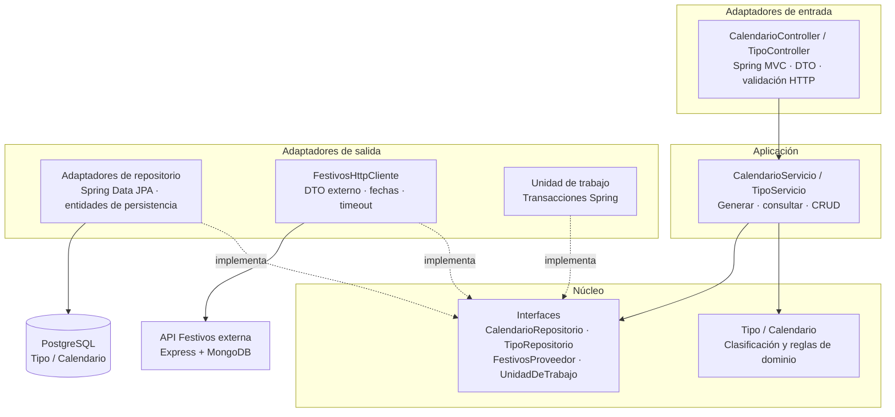

# Arquitectura Onion — API Calendario

La API genera y consulta calendarios anuales y administra tipos de día. El núcleo define las reglas y los contratos; los adaptadores REST, HTTP y de persistencia dependen de esos contratos, no al revés.

## Dependencias de código

Las flechas representan **dependencias de código**, no el orden de ejecución de una solicitud. Las líneas discontinuas indican que un adaptador implementa una interfaz interna.

- **Núcleo:** objetos Java y reglas; no importa Spring, JPA, HTTP ni clases de adaptadores.
- **Aplicación:** coordina casos de uso mediante interfaces internas. No conoce repositorios Spring Data ni clientes HTTP concretos.
- **Entrada REST:** transforma solicitudes y resultados mediante DTO; traduce errores a HTTP. No devuelve entidades JPA directamente.
- **Persistencia:** implementa los repositorios internos y mapea dominio ↔ entidades JPA.
- **Integración:** implementa `FestivosProveedor`; transforma la respuesta de API1 a fechas del dominio.
- **Transacciones:** `UnidadDeTrabajo` permite ejecutar el reemplazo anual de forma atómica sin introducir dependencias de Spring en los casos de uso.
- **Configuración:** `SpringBootApplication` compone e inyecta las implementaciones. El arranque no es una capa por la que pase cada petición.

## Casos de uso

| Caso | Comportamiento |
| --- | --- |
| Generar año | Consultar API1, validar sus datos, clasificar todas las fechas, reemplazar el año en una transacción y devolver `true` tras confirmar. |
| Consultar año | Leer únicamente los días persistidos, ordenados por fecha, sin llamar a API1. |
| Administrar tipos | Crear, listar, consultar, cambiar nombres y eliminar tipos sin referencias. |

Las rutas, cuerpos y errores se especifican en [Contratos REST](./ContratosAPI.md).

## Clasificación

La generación recorre las fechas con `LocalDate`, sin horas ni conversiones de zona horaria. Aplica estas reglas en orden:

1. Fecha recibida de API1: tipo `3`, **Dia festivo**, incluso en fin de semana.
2. Sábado o domingo no festivo: tipo `2`, **Fin de Semana**.
3. Cualquier otra fecha: tipo `1`, **Dia laboral**.

Los identificadores determinan la categoría; cambiar el nombre no cambia su función. Los tipos adicionales son administrables, pero no se asignan automáticamente. Si falta uno de los tres tipos de generación, la operación se rechaza antes de escribir datos.

`Calendario.Descripcion` contiene el día de la semana en español, como `Domingo` o `Lunes`, no el nombre del festivo. No se recalculan Pascua ni traslados al lunes.

## Generación segura

1. Validar el año y obtener la lista anual mediante `GET /api/festivos/obtener/{anio}`.
2. Validar estructura, fechas ISO y pertenencia al año; las fechas repetidas se consideran una sola para clasificar. Una lista vacía válida no es un error de transporte.
3. Preparar los 365 o 366 días sin modificar la base de datos.
4. Dentro de una transacción, comprobar los tipos necesarios y reemplazar exclusivamente los registros del año solicitado.
5. Confirmar y devolver `true`. Ante un fallo, revertir y conservar el calendario previo.

La llamada HTTP ocurre fuera de la transacción de escritura. La unicidad de `Fecha` y las claves foráneas protegen la integridad; las generaciones concurrentes del mismo año se serializan en PostgreSQL mediante un bloqueo transaccional por año, incluso cuando aún no existen filas de ese año. La comprobación de tipos y las escrituras participan en la misma transacción; una eliminación concurrente nunca puede dejar días huérfanos.

Regenerar mantiene las fechas y sus clasificaciones sin duplicarlas, pero no garantiza conservar los identificadores diarios. La generación no escribe otros años. Los detalles del modelo se encuentran en [Modelo relacional](./DiagramaRelacional-Taller2.md).
