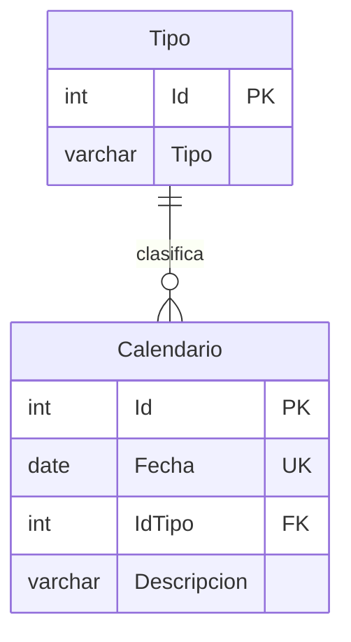

# Modelo relacional — API Calendario

`Tipo` clasifica los días de `Calendario`. Se conservan las dos entidades y sus campos; cada día referencia exactamente un tipo.

## Diagrama entidad–relación

## Campos y representación

| Campo | Almacenamiento y uso |
| --- | --- |
| `Tipo.Id` | Entero positivo, asignado al crear mediante el CRUD e inmutable. |
| `Tipo.Tipo` | `varchar(100) NOT NULL`; nombre editable, sin espacios exteriores ni texto vacío. |
| `Calendario.Id` | Entero positivo generado por PostgreSQL para cada registro diario. |
| `Calendario.Fecha` | `date NOT NULL UNIQUE`; fecha sin hora ni zona horaria. |
| `Calendario.IdTipo` | Entero `NOT NULL`, clave foránea hacia `Tipo.Id`. |
| `Calendario.Descripcion` | `varchar(20) NOT NULL`; día de la semana en español, como `Domingo` o `Lunes`. |

Los identificadores diarios usan una secuencia; pueden cambiar al regenerar y no tienen que ser consecutivos. Los identificadores de tipo no usan esa secuencia: se proporcionan explícitamente para conservar la identidad de las categorías.

La relación es **uno a cero o muchos** desde `Tipo` y **exactamente uno** desde `Calendario`. No se crea una tabla por año ni se almacenan únicamente festivos: un año generado comprende 365 o 366 registros.

La API devuelve `id`, `fecha`, `tipo { id, tipo }` y `descripcion`. La propiedad anidada `tipo` representa la relación, no una columna adicional. Los modelos del dominio no llevan anotaciones JPA; las entidades de persistencia externas realizan el mapeo.

## Tipos de día y CRUD

La carga inicial incorpora `1: Dia laboral`, `2: Fin de Semana` y `3: Dia festivo`. La clasificación usa estos identificadores, no sus nombres. No deben confundirse con los tipos de cálculo de API Festivos.

- Se permite crear tipos adicionales y editar nombres; no se agregan reglas de clasificación por crear un tipo.
- Se permite eliminar cualquier tipo sin días asociados. Para generar se necesitan los tres identificadores base; si falta uno, se debe restaurar mediante el CRUD.
- La eliminación de un tipo referenciado se rechaza tanto en el servicio como mediante una clave foránea con `ON DELETE RESTRICT`.
- No se eliminan días en cascada ni se cambia su tipo automáticamente.
- Modificar el nombre se refleja en los días asociados al consultar, sin cambiar su clasificación.

## Integridad y generación

- Ambos `Id` son claves primarias positivas; el nombre del tipo no es clave ni necesita ser único.
- `Fecha` es única globalmente: una fecha incluye el año y no puede duplicarse al regenerar.
- Las escrituras del calendario se realizan únicamente mediante la generación anual; no hay CRUD de días individuales.
- Reemplazar un año exige una transacción y un bloqueo transaccional por año para serializar generaciones concurrentes. No modifica registros de otros años.
- La unicidad por sí sola no garantiza que el año esté completo: el caso de uso comprueba cantidad y cobertura de fechas antes de confirmar.

El flujo se detalla en [Arquitectura Onion](./DiagramaArquitectura-Taller2.md) y las solicitudes en [Contratos REST](./ContratosAPI.md).
